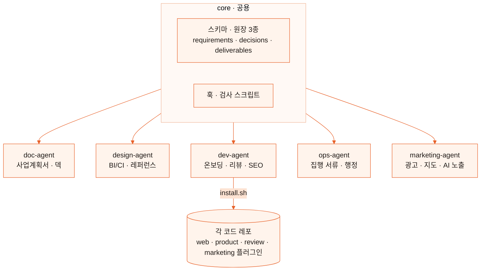

  

      

> A multi-agent harness that lets one founder ship grant proposals, client websites and SaaS products. 70 skills, 15+ subagents, and hooks that block the mistakes I kept repeating.
>
> 1인 회사가 사업계획서 · 클라이언트 웹 · SaaS를 혼자 납품하게 만든 Claude Code 멀티 에이전트 하네스. 반복된 실수는 말이 아니라 훅으로 막는다.

**Status** 매일 실사용 중 · **Code** private (이 레포는 구조와 설계 원칙만)

---

## 1. 왜 만들었나

지금.lab은 팀원이 없다. 매출의 70%는 정부지원사업 컨설팅, 20%는 자체 SaaS, 10%는 교육이다. 일의 종류가 너무 달라서 범용 AI 하나로는 품질이 안 나왔다. 그래서 **영역마다 규칙 · 스킬 · 검사기를 따로 둔 하네스**를 만들었다.

## 2. 구조

| 영역 | 스킬 | 대표 산출물 |
|---|---|---|
| doc | 10 | 사업계획서 · 발표 덱 · 도식 |
| design | 13 | 레퍼런스 12장 시트 · 브랜드 가이드 |
| dev | 32 | 레포 온보딩 · 4축 코드 리뷰 · SEO/AEO/GEO 감사 |
| ops | 6 | 사업비 집행 서류 · 견적 |
| marketing | 3 | 광고 · 지도 · AI 노출 세팅 |
| core | 6 | 원장 스키마 · 딥서치(앙상블 교차 검증) · 비평 |

## 3. 설계 원칙

| 원칙 | 구현 |
|---|---|
| **1세션 = 1영역 = 1클라이언트** | 영역 폴더마다 CLAUDE.md. 다른 영역 일이 섞이면 멈추고 새 세션 |
| **반복 지적은 기계 검사로** | 같은 지적이 두 번 나오면 말로 남기지 않고 `bans.json`(편집 훅) 또는 audit 항목으로 옮긴다 |
| **작성자와 평가자 분리** | 코드 리뷰 · QA는 별도 서브에이전트. 쓴 세션이 자기 결과를 채점하지 않는다 |
| **원장으로 상태 관리** | 요구사항 · 결정 · 산출물을 마크다운 원장 3종에 남기고 게이트 필드로 단계를 넘긴다 |
| **검증 후 보고** | 웹은 헤드리스 스크린샷(390 · 1440)과 audit FAIL 0이 완료 조건 |
| **환각 금지** | 확인 안 된 수치는 `(확인 필요)` · `(추정)` 태그. 딥서치는 출처 A~D 등급과 모델 앙상블 대조 |

## 4. 대표 파이프라인

**클라이언트 웹**: brief → refs(레퍼런스 12장) → dna(실측) → sian(시안 2~3개) → lock(토큰 잠금) → ui-kit → qa

**코드 리뷰**: 린터 · 타입 · 테스트 → 4축 병렬 리뷰(AI 슬롭 · 보안 · 정확성 · 유지보수성) → 판정

**노출 최적화**: 키워드 리서치 → SEO · AEO · GEO 4레인 감사 → 경영 보고서 + 실행명세

## 5. 성과

| 지표 | 값 |
|---|---|
| 1인으로 운영 중인 라이브 서비스 | 10개 (SaaS 4 · 클라이언트 웹 6) |
| 정부지원사업 수주 (본인 · 2024~2026) | 7건 |

---

<a href="https://github.com/TreeJin99">← 남우진 프로필</a> · <a href="https://jigeum.info">jigeum.info</a>

